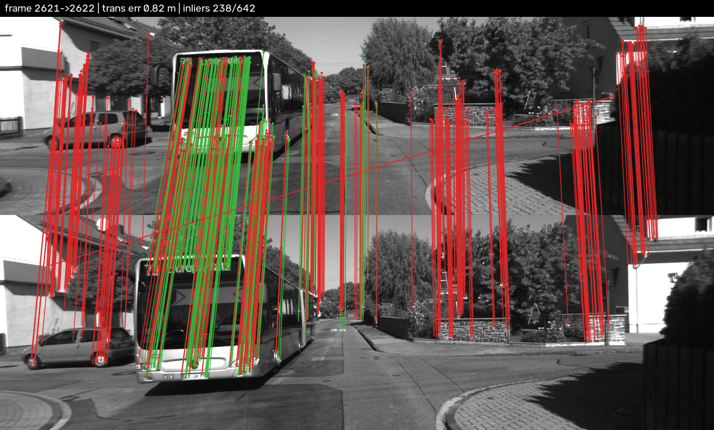

# 실패 분석: 시퀀스 05 / orb

## 오차 상위 10 프레임

| 프레임 | 이동 오차 (m) | 회전 오차 (°) | GT 회전 속도 (°/frame) | 인라이어 | 원인 후보 |
|---|---|---|---|---|---|
| 2622 | 0.816 | 0.220 | 0.19 | 238 | 확인 필요 (움직이는 물체·반복 패턴 등, 이미지로 확인) |
| 2623 | 0.800 | 0.087 | 0.16 | 197 | 확인 필요 (움직이는 물체·반복 패턴 등, 이미지로 확인) |
| 2621 | 0.797 | 0.081 | 0.11 | 253 | 확인 필요 (움직이는 물체·반복 패턴 등, 이미지로 확인) |
| 2586 | 0.145 | 0.099 | 0.19 | 462 | 확인 필요 (움직이는 물체·반복 패턴 등, 이미지로 확인) |
| 1500 | 0.125 | 0.256 | 0.43 | 475 | 확인 필요 (움직이는 물체·반복 패턴 등, 이미지로 확인) |
| 2452 | 0.125 | 0.088 | 0.14 | 286 | 확인 필요 (움직이는 물체·반복 패턴 등, 이미지로 확인) |
| 978 | 0.123 | 0.042 | 0.16 | 574 | 확인 필요 (움직이는 물체·반복 패턴 등, 이미지로 확인) |
| 1502 | 0.122 | 0.280 | 0.43 | 454 | 확인 필요 (움직이는 물체·반복 패턴 등, 이미지로 확인) |
| 234 | 0.109 | 0.072 | 0.07 | 322 | 확인 필요 (움직이는 물체·반복 패턴 등, 이미지로 확인) |
| 2635 | 0.097 | 0.051 | 0.66 | 453 | 확인 필요 (움직이는 물체·반복 패턴 등, 이미지로 확인) |

## 회전 속도별 평균 오차

| GT 회전 속도 (°/frame) | 프레임 수 | 평균 이동 오차 (m) | 평균 회전 오차 (°) |
|---|---|---|---|
| 직진 (< 0.5) | 2063 | 0.024 | 0.050 |
| 완만한 회전 (0.5 ~ 1.5) | 388 | 0.020 | 0.054 |
| 급회전 (≥ 1.5) | 309 | 0.022 | 0.054 |

## 인라이어 수별 평균 오차

| PnP 인라이어 | 프레임 수 | 평균 이동 오차 (m) | 평균 회전 오차 (°) |
|---|---|---|---|
| ≥ 150 | 2760 | 0.023 | 0.051 |

## 매칭 이미지

초록: PnP 인라이어, 빨강: 아웃라이어 또는 깊이 없음

