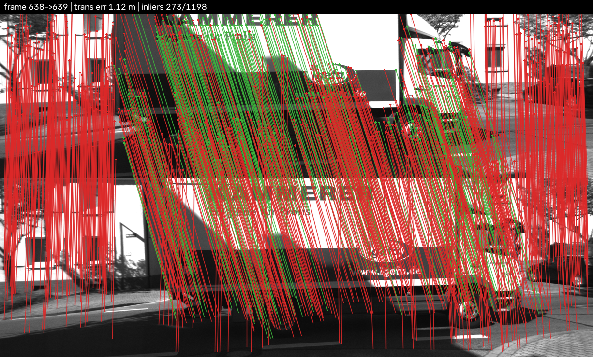

# 실패 분석: 시퀀스 07 / superpoint

## 오차 상위 10 프레임

| 프레임 | 이동 오차 (m) | 회전 오차 (°) | GT 회전 속도 (°/frame) | 인라이어 | 원인 후보 |
|---|---|---|---|---|---|
| 638 | 1.144 | 0.424 | 0.10 | 256 | 확인 필요 (움직이는 물체·반복 패턴 등, 이미지로 확인) |
| 640 | 1.134 | 0.478 | 0.07 | 336 | 확인 필요 (움직이는 물체·반복 패턴 등, 이미지로 확인) |
| 639 | 1.124 | 0.931 | 0.07 | 270 | 확인 필요 (움직이는 물체·반복 패턴 등, 이미지로 확인) |
| 641 | 0.098 | 0.225 | 0.10 | 238 | 확인 필요 (움직이는 물체·반복 패턴 등, 이미지로 확인) |
| 637 | 0.054 | 0.239 | 0.17 | 264 | 확인 필요 (움직이는 물체·반복 패턴 등, 이미지로 확인) |
| 716 | 0.053 | 0.001 | 0.01 | 1336 | 확인 필요 (움직이는 물체·반복 패턴 등, 이미지로 확인) |
| 1063 | 0.051 | 0.046 | 0.47 | 902 | 확인 필요 (움직이는 물체·반복 패턴 등, 이미지로 확인) |
| 128 | 0.044 | 0.055 | 2.82 | 877 | 급회전 |
| 643 | 0.043 | 0.075 | 0.17 | 452 | 확인 필요 (움직이는 물체·반복 패턴 등, 이미지로 확인) |
| 846 | 0.041 | 0.034 | 0.22 | 728 | 확인 필요 (움직이는 물체·반복 패턴 등, 이미지로 확인) |

## 회전 속도별 평균 오차

| GT 회전 속도 (°/frame) | 프레임 수 | 평균 이동 오차 (m) | 평균 회전 오차 (°) |
|---|---|---|---|
| 직진 (< 0.5) | 743 | 0.016 | 0.035 |
| 완만한 회전 (0.5 ~ 1.5) | 175 | 0.012 | 0.042 |
| 급회전 (≥ 1.5) | 182 | 0.015 | 0.055 |

## 인라이어 수별 평균 오차

| PnP 인라이어 | 프레임 수 | 평균 이동 오차 (m) | 평균 회전 오차 (°) |
|---|---|---|---|
| ≥ 150 | 1100 | 0.015 | 0.039 |

## 매칭 이미지

초록: PnP 인라이어, 빨강: 아웃라이어 또는 깊이 없음

