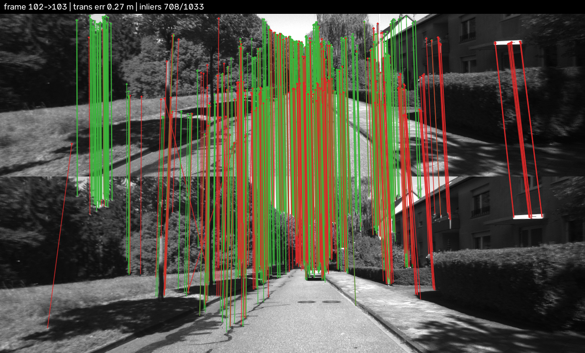
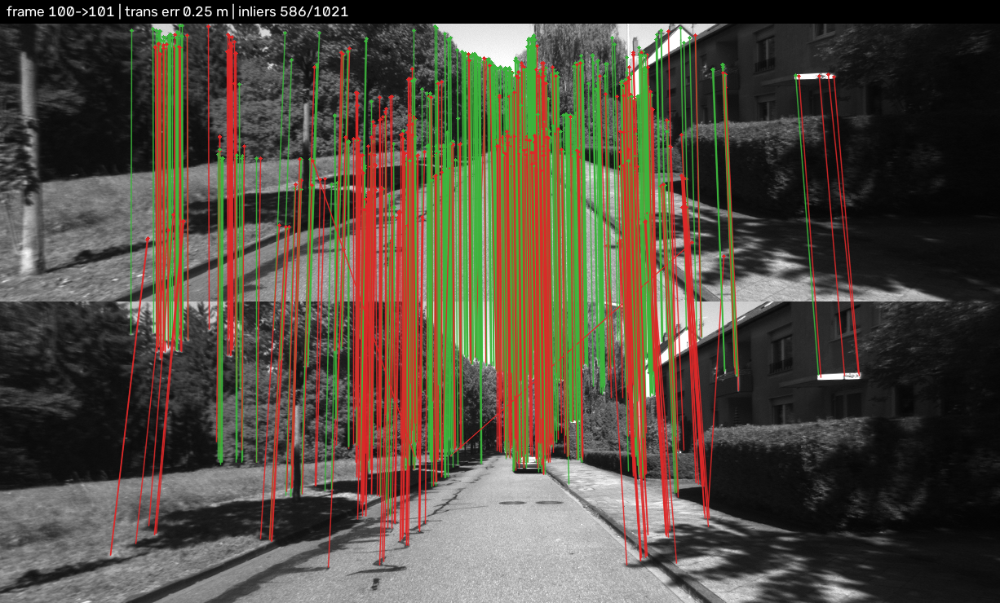
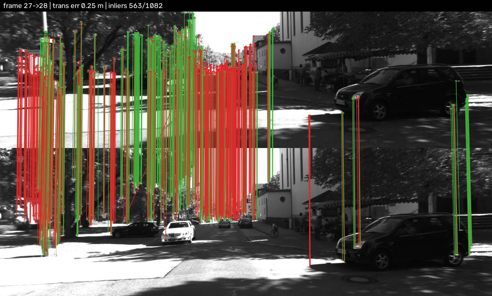
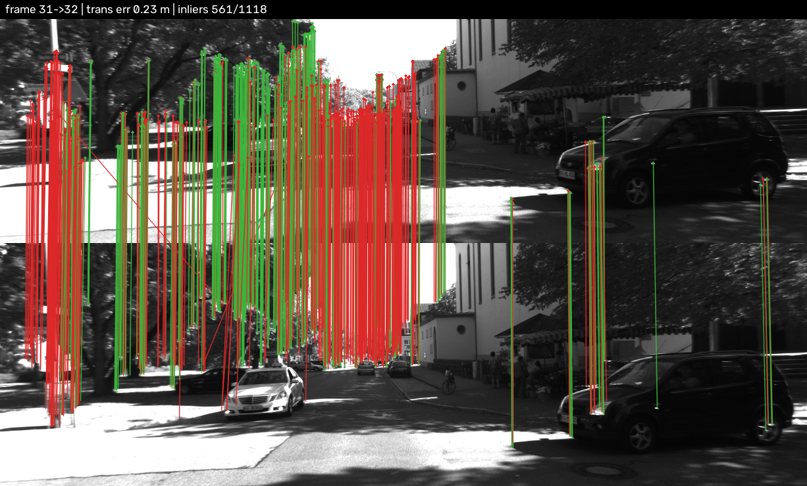
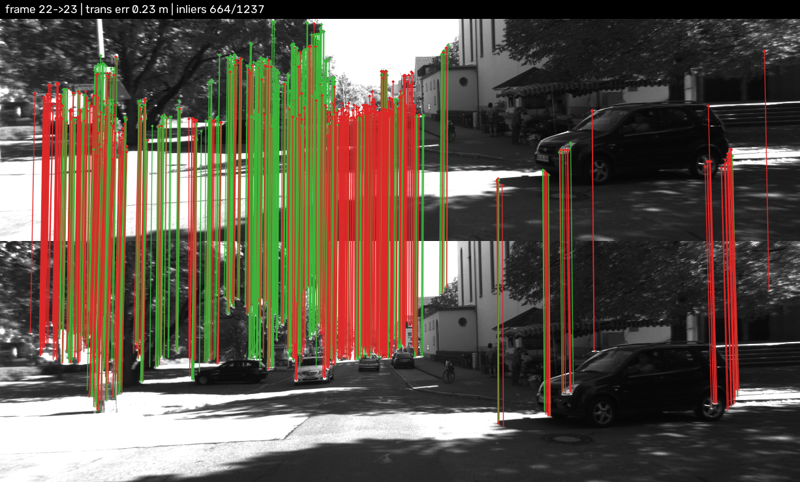
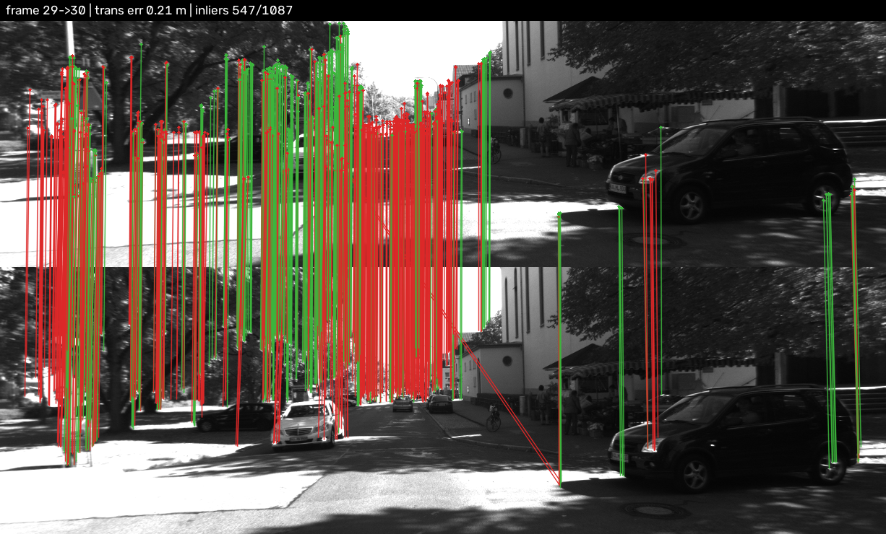
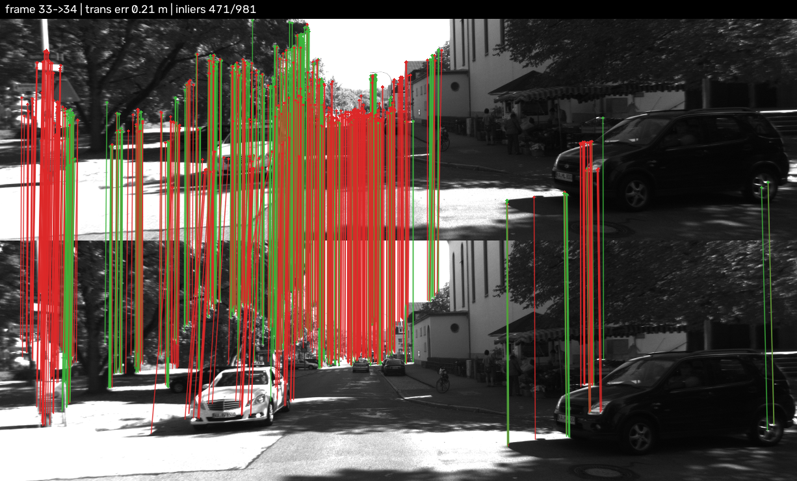
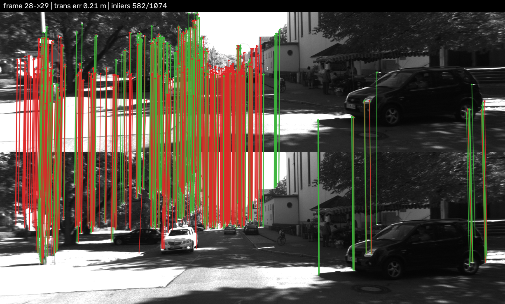
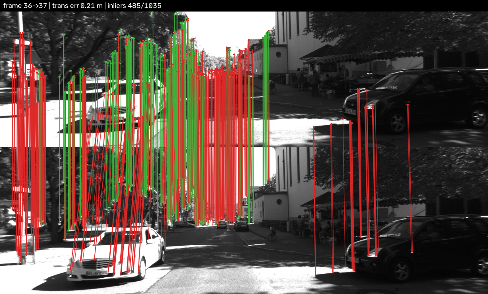
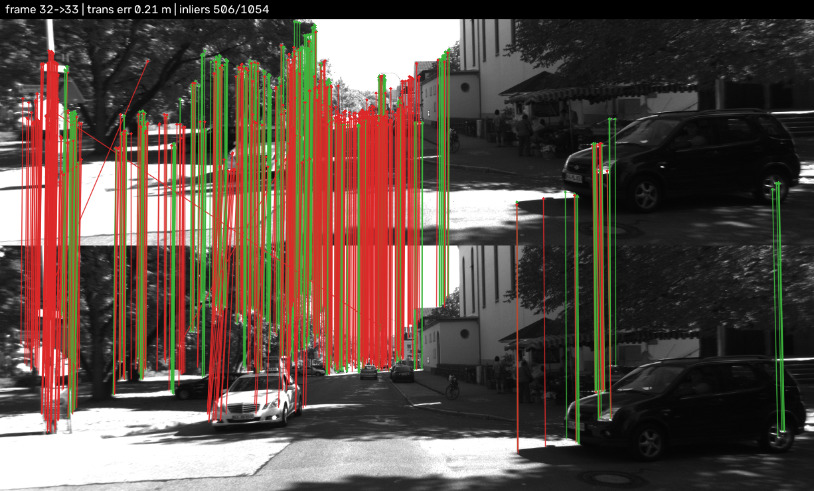

# 실패 분석: 시퀀스 08 / orb

## 오차 상위 10 프레임

| 프레임 | 이동 오차 (m) | 회전 오차 (°) | GT 회전 속도 (°/frame) | 인라이어 | 원인 후보 |
|---|---|---|---|---|---|
| 103 | 0.268 | 0.064 | 0.41 | 708 | 확인 필요 (움직이는 물체·반복 패턴 등, 이미지로 확인) |
| 101 | 0.253 | 0.021 | 0.39 | 586 | 확인 필요 (움직이는 물체·반복 패턴 등, 이미지로 확인) |
| 28 | 0.249 | 0.043 | 0.14 | 563 | 확인 필요 (움직이는 물체·반복 패턴 등, 이미지로 확인) |
| 32 | 0.232 | 0.063 | 0.12 | 561 | 확인 필요 (움직이는 물체·반복 패턴 등, 이미지로 확인) |
| 23 | 0.232 | 0.049 | 0.17 | 664 | 확인 필요 (움직이는 물체·반복 패턴 등, 이미지로 확인) |
| 30 | 0.215 | 0.042 | 0.15 | 547 | 확인 필요 (움직이는 물체·반복 패턴 등, 이미지로 확인) |
| 34 | 0.213 | 0.005 | 0.14 | 471 | 확인 필요 (움직이는 물체·반복 패턴 등, 이미지로 확인) |
| 29 | 0.213 | 0.033 | 0.16 | 582 | 확인 필요 (움직이는 물체·반복 패턴 등, 이미지로 확인) |
| 37 | 0.213 | 0.054 | 0.14 | 485 | 확인 필요 (움직이는 물체·반복 패턴 등, 이미지로 확인) |
| 33 | 0.211 | 0.024 | 0.15 | 506 | 확인 필요 (움직이는 물체·반복 패턴 등, 이미지로 확인) |

## 회전 속도별 평균 오차

| GT 회전 속도 (°/frame) | 프레임 수 | 평균 이동 오차 (m) | 평균 회전 오차 (°) |
|---|---|---|---|
| 직진 (< 0.5) | 2814 | 0.028 | 0.052 |
| 완만한 회전 (0.5 ~ 1.5) | 646 | 0.028 | 0.056 |
| 급회전 (≥ 1.5) | 610 | 0.040 | 0.055 |

## 인라이어 수별 평균 오차

| PnP 인라이어 | 프레임 수 | 평균 이동 오차 (m) | 평균 회전 오차 (°) |
|---|---|---|---|
| ≥ 150 | 4070 | 0.030 | 0.053 |

## 매칭 이미지

초록: PnP 인라이어, 빨강: 아웃라이어 또는 깊이 없음

