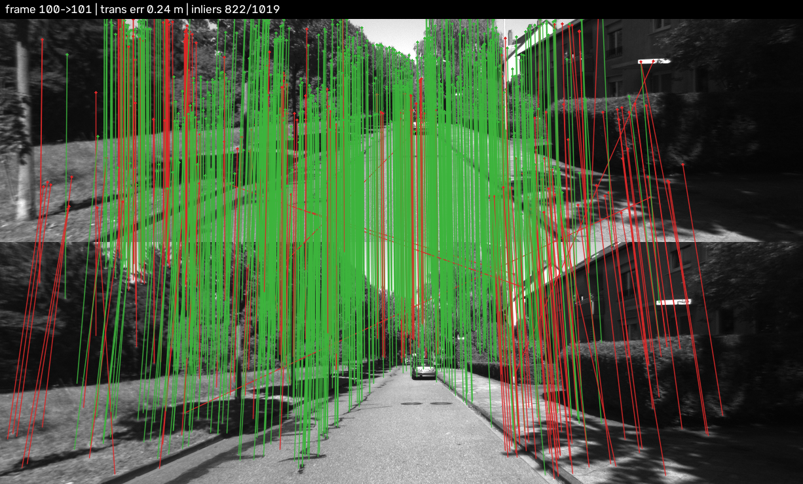
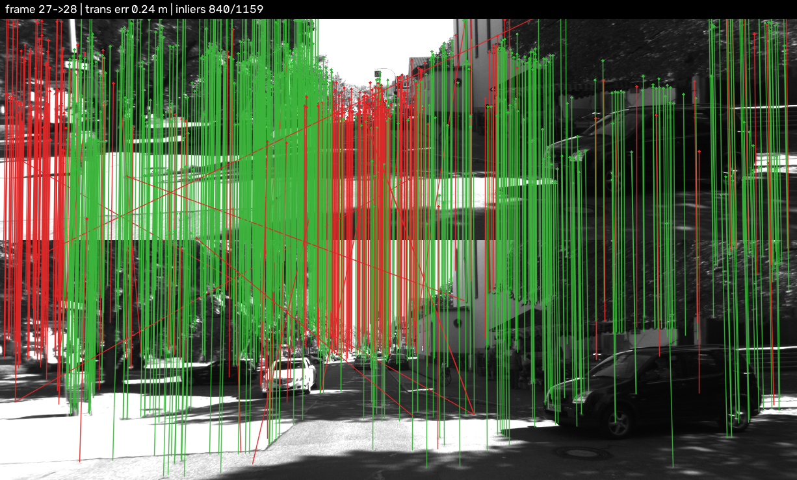
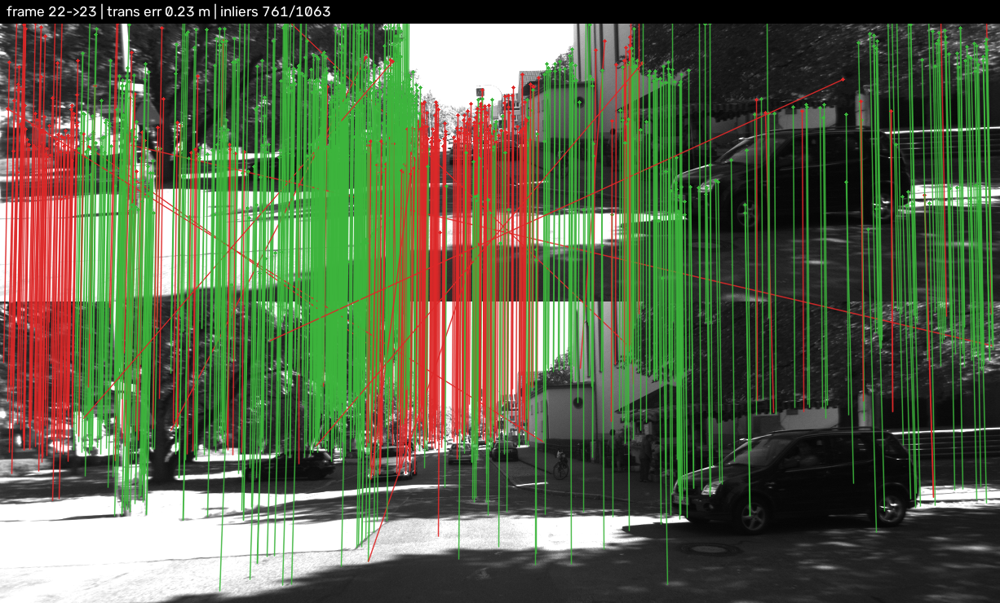
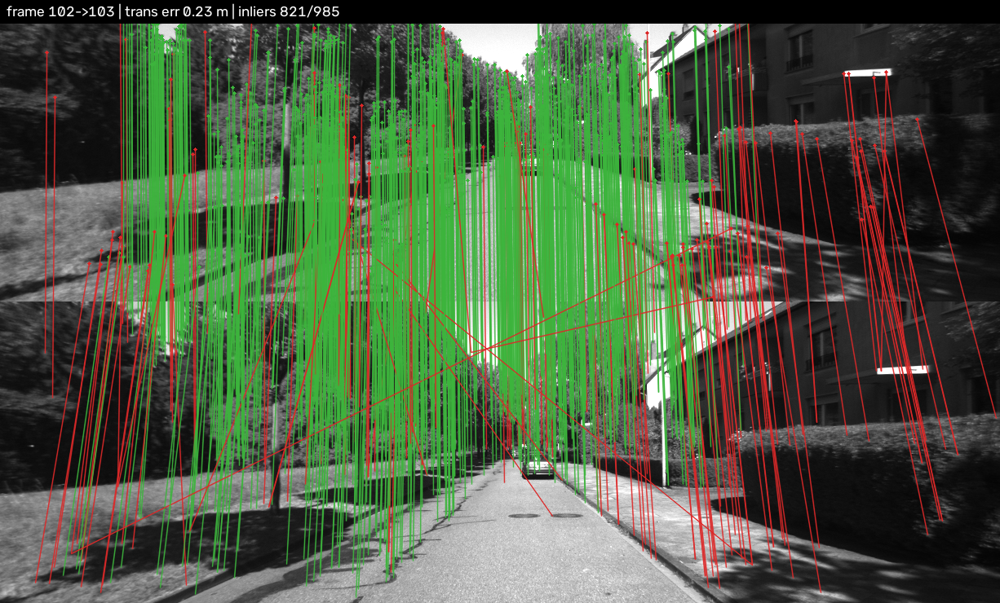
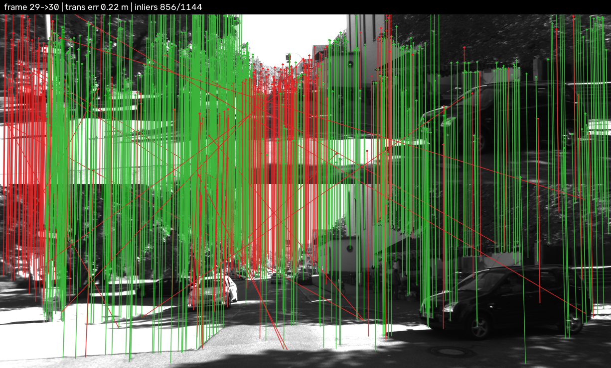
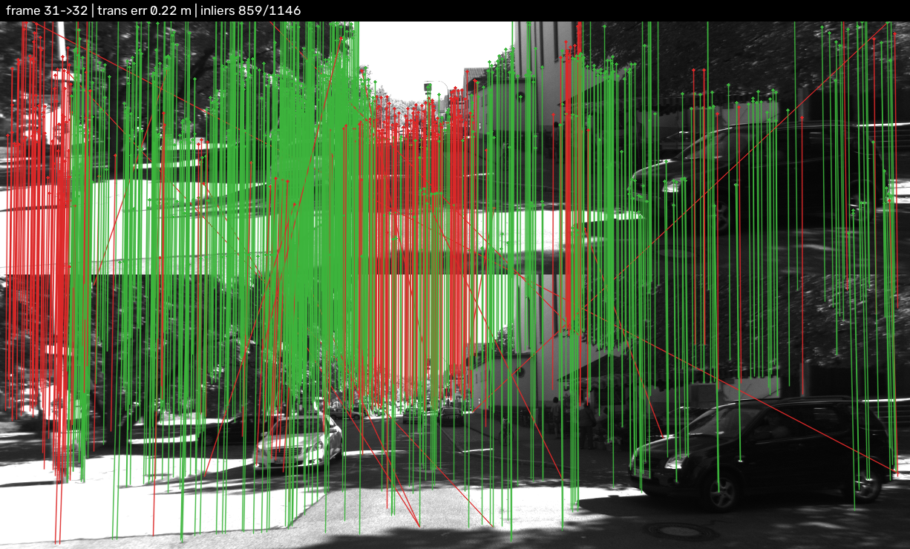
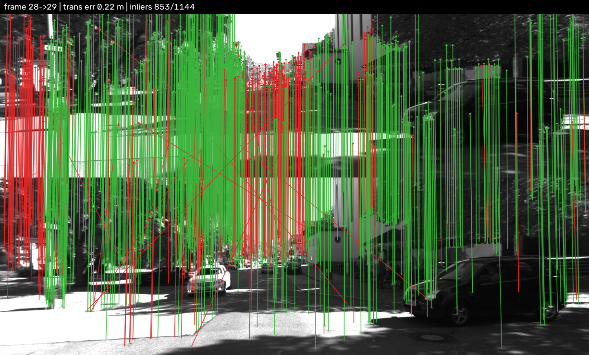
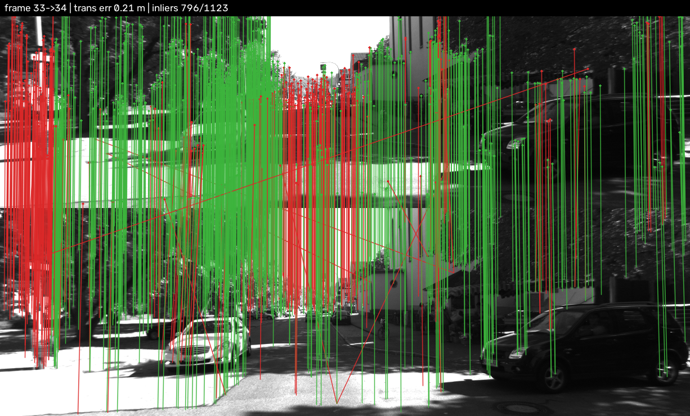
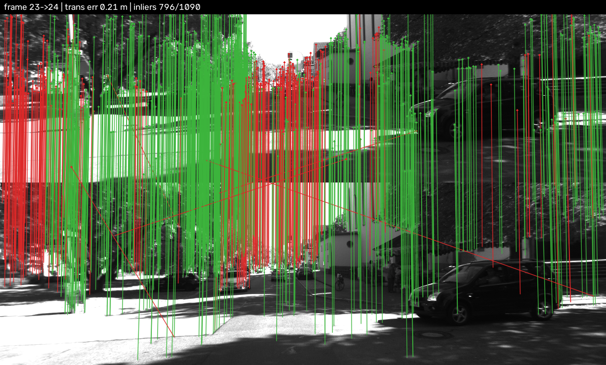
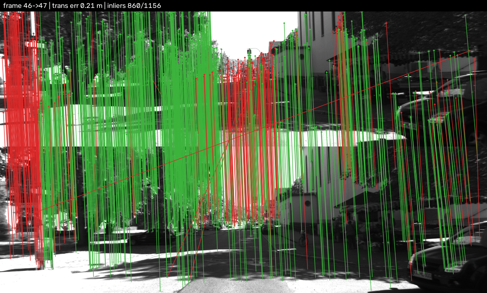

# 실패 분석: 시퀀스 08 / sift

## 오차 상위 10 프레임

| 프레임 | 이동 오차 (m) | 회전 오차 (°) | GT 회전 속도 (°/frame) | 인라이어 | 원인 후보 |
|---|---|---|---|---|---|
| 101 | 0.245 | 0.018 | 0.39 | 822 | 확인 필요 (움직이는 물체·반복 패턴 등, 이미지로 확인) |
| 28 | 0.242 | 0.000 | 0.14 | 840 | 확인 필요 (움직이는 물체·반복 패턴 등, 이미지로 확인) |
| 23 | 0.233 | 0.014 | 0.17 | 761 | 확인 필요 (움직이는 물체·반복 패턴 등, 이미지로 확인) |
| 103 | 0.231 | 0.050 | 0.41 | 821 | 확인 필요 (움직이는 물체·반복 패턴 등, 이미지로 확인) |
| 30 | 0.219 | 0.000 | 0.15 | 856 | 확인 필요 (움직이는 물체·반복 패턴 등, 이미지로 확인) |
| 32 | 0.216 | 0.012 | 0.12 | 859 | 확인 필요 (움직이는 물체·반복 패턴 등, 이미지로 확인) |
| 29 | 0.215 | 0.026 | 0.16 | 853 | 확인 필요 (움직이는 물체·반복 패턴 등, 이미지로 확인) |
| 34 | 0.212 | 0.000 | 0.14 | 796 | 확인 필요 (움직이는 물체·반복 패턴 등, 이미지로 확인) |
| 24 | 0.208 | 0.003 | 0.14 | 796 | 확인 필요 (움직이는 물체·반복 패턴 등, 이미지로 확인) |
| 47 | 0.208 | 0.011 | 1.11 | 860 | 확인 필요 (움직이는 물체·반복 패턴 등, 이미지로 확인) |

## 회전 속도별 평균 오차

| GT 회전 속도 (°/frame) | 프레임 수 | 평균 이동 오차 (m) | 평균 회전 오차 (°) |
|---|---|---|---|
| 직진 (< 0.5) | 2814 | 0.021 | 0.032 |
| 완만한 회전 (0.5 ~ 1.5) | 646 | 0.021 | 0.039 |
| 급회전 (≥ 1.5) | 610 | 0.035 | 0.044 |

## 인라이어 수별 평균 오차

| PnP 인라이어 | 프레임 수 | 평균 이동 오차 (m) | 평균 회전 오차 (°) |
|---|---|---|---|
| ≥ 150 | 4070 | 0.023 | 0.035 |

## 매칭 이미지

초록: PnP 인라이어, 빨강: 아웃라이어 또는 깊이 없음

